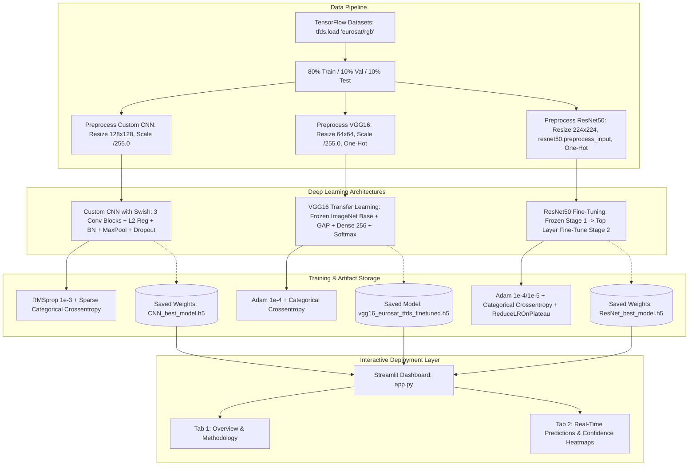

# PROJECT CONTEXT: EuroSAT Land Use & Land Cover Classification (Internship Project)

## 1. Purpose & Scope
The **EuroSAT Land Use & Land Cover Classification** project is a comparative deep learning and remote sensing benchmark system that classifies Sentinel-2 satellite Earth observation images into 10 distinct Land Use and Land Cover (LULC) categories (`AnnualCrop`, `Forest`, `HerbaceousVegetation`, `Highway`, `Industrial`, `Pasture`, `PermanentCrop`, `Residential`, `River`, `SeaLake`). It implements and benchmarks three distinct computer vision paradigms—a **Custom Deep CNN with Swish Activation** (95.13% test accuracy), **VGG16 Transfer Learning** (93.11% test accuracy), and a two-stage **ResNet50 Fine-Tuning Pipeline** (97.15% test accuracy)—integrated with a real-time interactive **Streamlit** prediction dashboard.

---

## 2. Architecture Overview

### High-Level Component Diagram


### Component Communication Mechanisms
1. **TensorFlow Dataset Pipelines (`tf.data.Dataset`)**: Data streams asynchronously using `.map(preprocess_fn, AUTOTUNE).batch(32).prefetch(AUTOTUNE)` for maximum GPU memory bandwidth utilization.
2. **Model Serialization (`.h5`)**: Checkpoints (`CNN_best_model.h5`, `ResNet_best_model.h5`, `vgg16_eurosat_tfds_finetuned.h5`) decouple offline GPU training execution in Jupyter Notebooks from the online Streamlit web application.
3. **Streamlit In-Memory Caching (`@st.cache_resource`)**: `app.py` caches the dataset download (`load_dataset()`) and model architecture definitions (`build_cnn_scratch()`, `build_resnet50()`, `build_vgg16()`) to prevent model re-compilation on every UI state change.

### State Lifecycle and Flow
- **Raw Input**: EuroSAT Sentinel-2 RGB image tensor $[64, 64, 3]$ uint8.
- **Model-Specific Transformations**:
  - `CNN_Scratch`: Resized to $[128, 128, 3]$, normalized $[0.0, 1.0]$, sparse integer label $y \in [0, 9]$.
  - `VGG16`: Kept at $[64, 64, 3]$, normalized $[0.0, 1.0]$, one-hot encoded vector $y \in \{0, 1\}^{10}$.
  - `ResNet50`: Upsampled to $[224, 224, 3]$, zero-centered via Caffe-style mean subtraction $[103.939, 116.779, 123.68]$ (RGB $\to$ BGR), one-hot encoded vector $y \in \{0, 1\}^{10}$.
- **Inference & Postprocessing**: Logits $\to$ Softmax probabilities $[1, 10] \to \text{argmax}$ predicted class $\to$ Inverse color transform for Matplotlib display $\to$ Seaborn probability heatmap.

---

## 3. Tech Stack & Why

| Technology | Version / Spec | Purpose & Architectural Justification |
| :--- | :--- | :--- |
| **Python** | 3.9+ (tested on 3.11.9) | Core language for machine learning, data science, and web dashboards. |
| **TensorFlow / Keras** | `tensorflow>=2.10.0` | Core deep learning framework. Implements custom Swish activations, transfer learning heads, backpropagation, and `.h5` checkpointing. |
| **TensorFlow Datasets** | `tensorflow_datasets` | Automated, reproducible data streaming provider for `eurosat/rgb` (27,000 images, 10 balanced classes, automatic 80/10/10 split). |
| **Streamlit** | `streamlit>=1.28.0` | Web application framework providing responsive sliders, dynamic metric cards, interactive image views, and sidebar routing. |
| **Seaborn & Matplotlib** | `seaborn`, `matplotlib` | Visualizing class probability heatmaps, confusion matrices, training convergence curves, and satellite image RGB previews. |
| **Pandas & NumPy** | `pandas`, `numpy` | Array vectorization, probability ranking DataFrames, and argmax prediction indexing. |

---

## 4. Directory & Module Map

```
Eurosat-lulc-benchmark/
├── README.md                           # Project description
├── app.py                             # Interactive Streamlit Web Application
├── CNN_Swish_final.ipynb               # Training pipeline for Custom CNN with Swish (95.13% Acc)
├── ResNet_Finetune_Eurosat.ipynb       # Two-stage fine-tuning pipeline for ResNet50 (97.15% Acc)
├── VGG16-model_final.ipynb             # Transfer learning pipeline for VGG16 (93.11% Acc)
├── Training_History/                   # Saved training & validation accuracy/loss plots
│   ├── CNN_training_history.png        # Custom CNN convergence curves
│   ├── ResNet50_training_history.png   # ResNet50 two-stage convergence curves
│   └── VGG_training_history.png        # VGG16 convergence curves
└── reports/                            # Formal laboratory and summary reports
    └── Summary and Comparison Report.pdf
```

### Module Responsibilities & Key Assets
- **`app.py`**: Full-stack Streamlit web dashboard. Contains cached model builders for all three architectures, dataset preprocessors, image display routines, and Seaborn confidence heatmap generators.
- **`CNN_Swish_final.ipynb`**: Custom CNN training notebook. Constructs 3 convolutional blocks with L2 regularization, custom `swish` activation ($x \cdot \sigma(x)$), RMSprop optimizer, and achieves **95.13%** test accuracy over 20 epochs.
- **`ResNet_Finetune_Eurosat.ipynb`**: ResNet50 training notebook. Employs a 2-stage transfer learning strategy (15 epochs feature extraction with frozen backbone $\to$ 15 epochs end-to-end fine-tuning with ReduceLROnPlateau), achieving the top benchmark score of **97.15%** test accuracy.
- **`VGG16-model_final.ipynb`**: VGG16 transfer learning notebook. Evaluates frozen VGG16 feature extraction on 64x64 EuroSAT images, achieving **93.11%** test accuracy.
- **`Training_History/`**: High-resolution PNGs illustrating training vs validation loss and accuracy trajectories for reporting.

---

## 5. Critical Files (The Load-Bearing Core)

### 1. `c:\Files\Coding\Projects\Eurosat-lulc-benchmark\app.py`
- **Why it's critical**: The unified deployment application. Integrates all three trained models into an interactive web interface with dynamic dataset sampling, preprocessing, and real-time visualization.
- **Key Functions/Classes**:
  - `load_dataset()`: Streams `eurosat/rgb` split from TFDS (`as_supervised=True`).
  - `swish(x)`: Custom activation function tensor implementation: `x * tf.nn.sigmoid(x)`.
  - `build_cnn_scratch()`: Builds the 12-layer custom CNN architecture with L2 regularization and Swish activations.
  - `build_resnet50()`: Builds the ResNet50 transfer learning head (`GlobalAveragePooling2D` $\to$ `Dense(256)` $\to$ `Dropout(0.5)` $\to$ `Dense(10)`).
  - `build_vgg16()`: Builds the VGG16 transfer learning head.
  - `preprocess_cnn_scratch(image, label)`, `preprocess_vgg16(...)`, `preprocess_resnet50(...)`: Model-specific image resizing, normalization, and label encoding.
  - Dynamic prediction loop: Unbatches test images, performs model inference, reverses ResNet50 mean-centering for correct visual display, renders confidence tables, and outputs Seaborn heatmaps.
- **Non-Obvious Details**:
  - ResNet50 uses `keras.applications.resnet50.preprocess_input`, which converts images from RGB to BGR and subtracts ImageNet channel means (`[103.939, 116.779, 123.68]`). To display the image correctly in Matplotlib, `app.py` explicitly inverts this transform: `image_display = (image + [103.939, 116.779, 123.68])[:, :, ::-1]`.

### 2. `c:\Files\Coding\Projects\Eurosat-lulc-benchmark\ResNet_Finetune_Eurosat.ipynb`
- **Why it's critical**: Produces the highest-performing model (**97.15% Test Accuracy**). Implements staged transfer learning and learning rate annealing.
- **Key Pipeline Steps**:
  - Data upsampling: Upsamples $64 \times 64$ Sentinel-2 images to $224 \times 224$ to match ResNet50's receptive field.
  - Stage 1 (Frozen Backbone): 15 epochs training only the custom top head using Adam ($lr = 10^{-4}$).
  - Stage 2 (Fine-Tuning): Unfreezes deep residual blocks, training end-to-end with Adam ($lr = 10^{-5}$), `ModelCheckpoint(save_best_only=True)`, and `ReduceLROnPlateau(patience=3, factor=0.2)`.
  - Evaluation: Computes classification report, precision/recall per class, and confusion matrix.
- **Non-Obvious Details**:
  - Fine-tuning achieves $>97\%$ accuracy because residual skip connections preserve high-frequency texture boundaries in agricultural and industrial satellite patches.

### 3. `c:\Files\Coding\Projects\Eurosat-lulc-benchmark\CNN_Swish_final.ipynb`
- **Why it's critical**: Proves that a lightweight custom CNN from scratch (~1.2M parameters) can rival large pretrained models when paired with Swish activation and aggressive regularization.
- **Key Pipeline Steps**:
  - Input resolution: Resizes images to $128 \times 128 \times 3$.
  - Layer layout: 3 paired Conv2D blocks (32 $\to$ 32 $\to$ 64 $\to$ 64 $\to$ 128 $\to$ 128 filters) with kernel size $3 \times 3$, `padding='same'`, and `kernel_regularizer=l2(0.001)`.
  - Normalization & Regularization: Every conv layer is followed by `Activation(swish)`, `BatchNormalization()`, and `MaxPooling2D(2, 2)` + `Dropout(0.3)`.
  - Classifier Head: `Flatten()` $\to$ `Dense(256, l2=0.001)` $\to$ `Activation(swish)` $\to$ `BatchNormalization()` $\to$ `Dropout(0.5)` $\to$ `Dense(10, softmax)`.
  - Optimization: RMSprop ($lr=0.001$) with `sparse_categorical_crossentropy`.
- **Non-Obvious Details**:
  - Swish activation ($x \cdot \text{sigmoid}(x)$) outperforms standard ReLU by allowing small negative gradients, preventing "dead neuron" saturation on dark satellite water and forest pixels.

### 4. `c:\Files\Coding\Projects\Eurosat-lulc-benchmark\VGG16-model_final.ipynb`
- **Why it's critical**: Serves as the classic sequential transfer learning baseline (**93.11% Test Accuracy**).
- **Key Pipeline Steps**:
  - Native resolution evaluation: Evaluates VGG16 on raw $64 \times 64$ inputs.
  - Frozen feature extraction: VGG16 convolutional backbone frozen with ImageNet weights.
  - Classification Head: `GlobalAveragePooling2D` $\to$ `Dense(256, relu)` $\to$ `Dropout(0.5)` $\to$ `Dense(10, softmax)`.
  - Optimization: Adam ($lr=10^{-4}$) with `categorical_crossentropy`.
- **Non-Obvious Details**:
  - VGG16 achieves lower accuracy (93.11%) compared to ResNet50 (97.15%) and Custom CNN (95.13%) primarily because VGG16's large pooling strides without residual connections lose fine spatial details at small $64 \times 64$ input dimensions.

```
PASTE THESE FILES VERBATIM:
- c:\Files\Coding\Projects\Eurosat-lulc-benchmark\app.py
- c:\Files\Coding\Projects\Eurosat-lulc-benchmark\CNN_Swish_final.ipynb
- c:\Files\Coding\Projects\Eurosat-lulc-benchmark\ResNet_Finetune_Eurosat.ipynb
- c:\Files\Coding\Projects\Eurosat-lulc-benchmark\VGG16-model_final.ipynb
```

---

## 6. Data & Control Flow (End-to-End)

### Step-by-Step Flow: Real-Time Streamlit Prediction Pipeline
```
[1] User launches Streamlit App: streamlit run app.py
    │
    ▼
[2] Data Initialization: load_dataset()
    │
    ├──> tfds.load('eurosat/rgb', split=['train[:80%]', 'train[80%:90%]', 'train[90%:]'])
    └──> Retrieves 10 class names: ['AnnualCrop', 'Forest', 'HerbaceousVegetation', ...]
    │
    ▼
[3] User navigates to "Real-Time Predictions" page & selects Model:
    │
    ├── Option A: "CNN_Scratch"
    │   ├── preprocess_fn: Resize to 128x128, scale pixels / 255.0
    │   ├── Model builder: build_cnn_scratch()
    │   └── Weights loader: Loads CNN_best_model.h5
    │
    ├── Option B: "VGG16"
    │   ├── preprocess_fn: Resize to 64x64, scale pixels / 255.0, one-hot encode label
    │   └── Model loader: Loads vgg16_eurosat_tfds_finetuned.h5 (custom_objects={'swish': swish})
    │
    └── Option C: "ResNet50"
        ├── preprocess_fn: Resize to 224x224, resnet50.preprocess_input, one-hot encode label
        ├── Model builder: build_resnet50()
        └── Weights loader: Loads ResNet_best_model.h5
    │
    ▼
[4] User selects number of predictions (Slider: 1-5) and clicks "Generate Predictions":
    │
    ├──> Randomly samples test image from unbatched ds_test
    ├──> Expands tensor dimensions: input_image = tf.expand_dims(image, axis=0)
    ├──> Runs inference: pred_probs = model.predict(input_image)
    ├──> Extracts predicted index: pred_class = np.argmax(pred_probs[0])
    │
    ▼
[5] Postprocessing & Visual Rendering:
    ├──> Reconstructs displayable RGB image:
    │    - For ResNet50: inverts BGR and adds ImageNet means: (image + [103.9, 116.7, 123.6])[:, :, ::-1]
    │    - For Custom CNN: clips image between [0.0, 1.0]
    ├──> Renders image with True vs. Predicted title badge
    ├──> Displays structured pandas DataFrame table with 4-decimal class confidence probabilities
    └──> Generates and displays Seaborn Blues confidence heatmap
```

---

## 7. Configuration & Environment

### EuroSAT Dataset Schema & Target Classes
- Dataset: EuroSAT RGB (Sentinel-2 satellite imagery, European Space Agency).
- Total Images: `27,000` color patches across 10 balanced classes (`2,700` images/class).
- 10 Land Use / Land Cover Classes:
  `0: AnnualCrop`, `1: Forest`, `2: HerbaceousVegetation`, `3: Highway`, `4: Industrial`, `5: Pasture`, `6: PermanentCrop`, `7: Residential`, `8: River`, `9: SeaLake`.

### Model Input Configurations & Hyperparameters
| Model | Input Resolution | Preprocessing | Optimizer | Loss Function | Parameters | Test Accuracy |
| :--- | :--- | :--- | :--- | :--- | :--- | :--- |
| **Custom CNN (Swish)** | $128 \times 128 \times 3$ | Scale $[0, 1]$ | RMSprop ($10^{-3}$) | Sparse Categorical CE | ~1.2M | **95.13%** |
| **VGG16 Transfer** | $64 \times 64 \times 3$ | Scale $[0, 1]$ | Adam ($10^{-4}$) | Categorical CE | ~14.7M | **93.11%** |
| **ResNet50 Fine-Tune** | $224 \times 224 \times 3$ | BGR Mean Subtraction | Adam ($10^{-4} \to 10^{-5}$) | Categorical CE | ~24.1M | **97.15%** |

### File Weights Map
- `CNN_best_model.h5`: ModelCheckpoint weights for Custom CNN.
- `ResNet_best_model.h5`: ModelCheckpoint weights for ResNet50.
- `vgg16_eurosat_tfds_finetuned.h5`: Serialized Keras H5 model for VGG16.

---

## 8. External Interfaces

1. **TensorFlow Datasets Catalog**: `tfds.load('eurosat/rgb')` downloads and caches the official ~90MB EuroSAT dataset tarball to `~/tensorflow_datasets/eurosat/`.
2. **Keras Applications ImageNet Registry**: Pretrained weights for `VGG16` and `ResNet50` downloaded automatically from `storage.googleapis.com/tensorflow/keras-applications/`.
3. **Streamlit UI Interface**: Web frontend accessible locally at `http://localhost:8501`.

---

## 9. Build, Run, Test, Deploy

### Environment Setup
```bash
# 1. Create and activate Python virtual environment
python -m venv venv
# Windows:
.\venv\Scripts\Activate.ps1
# Linux/macOS:
source venv/bin/activate

# 2. Install required packages
pip install tensorflow tensorflow-datasets streamlit numpy matplotlib seaborn pandas
```

### Running Model Training in Jupyter
```bash
# Launch Jupyter Lab / Notebook
jupyter notebook

# Execute notebooks in order:
# 1. CNN_Swish_final.ipynb         -> Trains Custom CNN and exports CNN_best_model.h5
# 2. ResNet_Finetune_Eurosat.ipynb -> Trains ResNet50 and exports ResNet_best_model.h5
# 3. VGG16-model_final.ipynb       -> Trains VGG16 and exports vgg16_eurosat_tfds_finetuned.h5
```

### Running the Streamlit Web Dashboard
```bash
streamlit run app.py
# If port 8501 is occupied:
streamlit run app.py --server.port 8502
```

---

## 10. Design Decisions & Trade-offs

1. **Swish Activation vs. Standard ReLU in Custom CNN**:
   - *Decision*: Use Swish ($f(x) = x \cdot \text{sigmoid}(x)$) across all convolutional layers in `CNN_Swish_final.ipynb`.
   - *Rationale*: Swish is non-monotonic and smooth, preserving small negative values that prevent gradient vanishing in dark satellite imagery (e.g. deep water, dense forest).
2. **Multi-Scale Input Dimensions ($64 \times 64$ vs $128 \times 128$ vs $224 \times 224$)**:
   - *Decision*: Train VGG16 at $64 \times 64$, Custom CNN at $128 \times 128$, and ResNet50 at $224 \times 224$.
   - *Rationale*: ResNet50's residual architecture was designed for $224 \times 224$ receptive fields. Bilinear upsampling gives ResNet50 superior contextual clarity, while the custom CNN achieves high efficiency at $128 \times 128$.
3. **TFDS Streaming vs. Local Folder Directories**:
   - *Decision*: Ingest EuroSAT via `tensorflow_datasets` rather than raw directory image trees.
   - *Rationale*: Guarantees deterministic, reproducible train/val/test splits (80/10/10) and avoids manual ZIP extraction dependencies across operating systems.
4. **L2 Regularization + Batch Normalization + Dropout Hierarchy**:
   - *Decision*: Combine L2 weight decay ($0.001$), Batch Normalization after every convolution, and Dropout ($0.3$ on conv, $0.5$ on dense) in the custom CNN.
   - *Rationale*: Satellite datasets have high intra-class variance; this 3-tier regularization prevents overfitting on seasonal land variations.

---

## 11. Known Issues, TODOs, Fragile Areas

1. **Missing Pre-trained `.h5` Files on Fresh Clone**:
   - *Fragile Area*: If `app.py` is launched before running the training notebooks, the `.h5` weights files (`CNN_best_model.h5`, `ResNet_best_model.h5`) will not exist. `app.py` handles this gracefully by displaying an alert and falling back to untrained weights, but predictions will be random until notebooks are run.
2. **First-Time TFDS Download Latency**:
   - *Fragile Area*: On first execution of `app.py`, `tfds.load('eurosat/rgb')` downloads the ~90MB dataset. A slow internet connection can cause the Streamlit spinner to take several minutes to load.
3. **Custom Swish Object Dependency in Keras Loading**:
   - *Fragile Area*: When loading Keras models saved with custom functions, `custom_objects={'swish': swish}` must be explicitly provided in `tf.keras.models.load_model()`.

---

## 12. "If You Wanted To..." — Common Modification Scenarios

### Scenario 1: Enable Local Image Upload in Streamlit Dashboard
- **Goal**: Allow users to drag-and-drop their own aerial or drone images for instant classification.
- **Files to touch**:
  - `app.py`:
    - Add `uploaded_file = st.file_uploader("Upload satellite image", type=["jpg", "png", "jpeg"])`.
    - Ingest uploaded bytes via `PIL.Image.open(uploaded_file)`.
    - Resize and preprocess image using the selected model's `preprocess_fn`.
    - Run `model.predict()` and render confidence scores.

### Scenario 2: Support 13-Band Multispectral EuroSAT Data
- **Goal**: Leverage non-RGB Sentinel-2 bands (Near-Infrared, Red Edge, SWIR) for vegetation and water detection.
- **Files to touch**:
  - `CNN_Swish_final.ipynb` & `app.py`:
    - Change input dataset from `'eurosat/rgb'` to `'eurosat/all'`.
    - Update model input shape from `(128, 128, 3)` to `(64, 64, 13)`.
    - Update `layers.Input(shape=(64, 64, 13))` in `build_cnn_scratch()`.

### Scenario 3: Upgrade to Vision Transformer (ViT)
- **Goal**: Benchmark a Vision Transformer against ResNet50.
- **Files to touch**:
  - Create notebook `ViT_Eurosat.ipynb`:
    - Import `from transformers import TFViTForImageClassification, ViTImageProcessor`.
    - Load pretrained `'google/vit-base-patch16-224'`.
    - Fine-tune with AdamW on EuroSAT RGB.
  - `app.py`: Add `"ViT"` to `st.selectbox` and add `build_vit()` loader.

### Scenario 4: Export to TensorFlow Lite for Drone Edge Deployment
- **Goal**: Convert the 95.13% Custom CNN model into an ultra-fast, quantized mobile format (`.tflite`).
- **Files to touch**:
  - Create `export_tflite.py`:
    - Load `CNN_best_model.h5` with custom swish.
    - Run `converter = tf.lite.TFLiteConverter.from_keras_model(model)`.
    - Set `converter.optimizations = [tf.lite.Optimize.DEFAULT]`.
    - Export `eurosat_model_quantized.tflite` for edge deployment.
