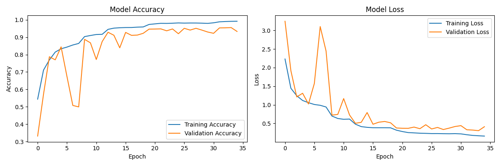
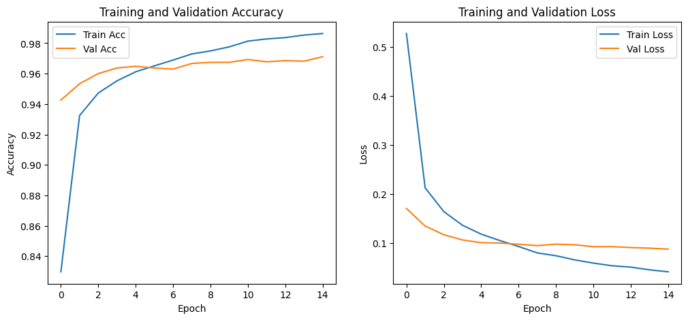
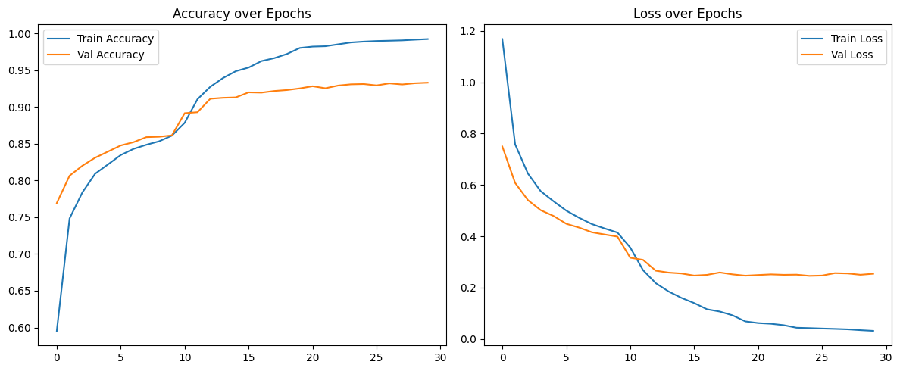

# EuroSAT Land Use & Land Cover (LULC) Classification Benchmark

[](https://www.python.org/)
[](https://www.tensorflow.org/)
[](https://streamlit.io/)
[](https://opensource.org/licenses/MIT)

A comparative deep learning and remote sensing benchmark system that classifies European Space Agency (ESA) Sentinel-2 satellite Earth observation imagery into 10 distinct Land Use and Land Cover (LULC) categories.

This project implements, evaluates, and benchmarks three distinct computer vision architectures:
1. **Custom Deep CNN with Swish Activation** (Built from scratch, ~1.2M parameters)
2. **ResNet50 Two-Stage Fine-Tuning** (Deep residual transfer learning, ~24.1M parameters)
3. **VGG16 Transfer Learning Baseline** (Sequential feature extraction, ~14.7M parameters)

The models are deployed in an interactive **Streamlit web dashboard** featuring real-time image sampling, inference confidence tables, and Seaborn probability distribution heatmaps.

---

## 1. Benchmark Overview & Results

The benchmark evaluates performance on the **EuroSAT RGB** dataset (27,000 georeferenced Sentinel-2 image patches, 64 x 64 pixels, 10 balanced classes).

| Architecture | Input Shape | Trainable Parameters | Optimizer & Loss | Reported Test Accuracy | Key Architectural Trait |
| :--- | :--- | :--- | :--- | :--- | :--- |
| **ResNet50 (Fine-Tuned)** | 224 x 224 x 3 | ~24.1M | Adam (1e-4 → 1e-5) + Categorical CE | **97.15%** | Two-stage fine-tuning with residual skip connections |
| **Custom CNN (Swish)** | 128 x 128 x 3 | ~1.2M | RMSprop (1e-3) + Sparse Categorical CE | **95.13%** | 3 Conv blocks with Swish activation, L2 decay & BatchNorm |
| **VGG16 (Feature Extractor)** | 64 x 64 x 3 | ~14.7M | Adam (1e-4) + Sparse/Categorical CE | **93.11%** | Classic sequential transfer learning baseline |

### Target LULC Categories (10 Classes)
- `AnnualCrop`
- `Forest`
- `HerbaceousVegetation`
- `Highway`
- `Industrial`
- `Pasture`
- `PermanentCrop`
- `Residential`
- `River`
- `SeaLake`

---

## 2. Training Convergence & Validation History

Training convergence trajectories across all three architectures are visualized below:

### Custom CNN with Swish Activation (95.13%)


### ResNet50 Two-Stage Fine-Tuning (97.15%)


### VGG16 Transfer Learning (93.11%)


---

## 3. Architecture Deep-Dive

### Custom Deep CNN with Swish
- **Input**: Resized to 128 x 128 x 3, normalized to [0.0, 1.0].
- **Core Design**:
  - Three dual-convolutional blocks (32 → 32 → 64 → 64 → 128 → 128 filters) with 3 x 3 kernels and `'same'` padding.
  - Replaces standard ReLU with the smooth, non-monotonic **Swish** activation (`f(x) = x * sigmoid(x)`), preserving small negative gradients across dark satellite water and forest pixels.
  - Multi-tier regularization: L2 weight regularization (0.001), Batch Normalization after every activation, and Dropout (0.3 on convolutions, 0.5 on dense).
- **Outcome**: Achieves **95.13%** accuracy with only ~1.2M parameters, proving high efficiency for remote sensing tasks.

### ResNet50 Two-Stage Fine-Tuning
- **Input**: Upsampled to 224 x 224 x 3, zero-centered via ImageNet BGR mean subtraction.
- **Stage 1 (Frozen Backbone)**: Trains a custom dense classification head (GlobalAveragePooling2D → Dense 256 ReLU → Dropout 0.5 → Softmax) for 15 epochs with Adam (lr = 1e-4).
- **Stage 2 (End-to-End Fine-Tuning)**: Unfreezes deep residual blocks, training at lower learning rate (lr = 1e-5) with `ReduceLROnPlateau` and checkpointing.
- **Outcome**: Achieves top benchmark performance of **97.15%** test accuracy.

### VGG16 Feature Extraction Baseline
- **Input**: Raw 64 x 64 x 3 Sentinel-2 resolution.
- **Structure**: Pre-trained ImageNet backbone frozen as feature extractor with custom dense classification head.
- **Outcome**: Establishes a classic sequential baseline (**93.11%** accuracy).

---

## 4. Repository Structure

```
Eurosat-lulc-benchmark/
├── README.md                           # Project documentation & benchmark analysis
├── requirements.txt                    # Locked Python dependencies
├── app.py                             # Interactive Streamlit Web Application
├── CNN_Swish_final.ipynb               # Custom Swish CNN training pipeline
├── ResNet_Finetune_Eurosat.ipynb       # ResNet50 fine-tuning pipeline
├── VGG16-model_final.ipynb             # VGG16 transfer learning notebook
├── PROJECT_CONTEXT.md                 # Complete system design & data flow document
├── Training_History/                   # High-resolution convergence plots
│   ├── CNN_training_history.png
│   ├── ResNet50_training_history.png
│   └── VGG_training_history.png
└── reports/                            # Formal project report
    └── Summary and Comparison Report.pdf
```

---

## 5. Quickstart & Installation

### 1. Prerequisites
- Python 3.9, 3.10, or 3.11
- Virtual environment tool (`venv` or `conda`)

### 2. Environment Setup
```bash
# Clone the repository
git clone https://github.com/Krishna2805/Eurosat-lulc-benchmark.git
cd Eurosat-lulc-benchmark

# Create and activate virtual environment
# Windows (PowerShell):
python -m venv venv
.\venv\Scripts\Activate.ps1

# Linux / macOS:
python3 -m venv venv
source venv/bin/activate

# Install required dependencies
pip install -r requirements.txt
```

### 3. Launching the Interactive Streamlit Dashboard
```bash
streamlit run app.py
```
Open your browser at `http://localhost:8501`. Use the sidebar to switch between the **Overview** page and the **Real-Time Predictions** interactive test harness.

### 4. Running Model Training in Jupyter
```bash
jupyter lab
```
Execute the notebooks in sequence:
1. `CNN_Swish_final.ipynb` → Trains Custom CNN and plots convergence curves.
2. `ResNet_Finetune_Eurosat.ipynb` → Executes 2-stage ResNet50 fine-tuning.
3. `VGG16-model_final.ipynb` → Evaluates VGG16 transfer learning baseline.

---

## 6. Project Reports & Documentation
Detailed methodology, confusion matrices, and per-class precision/recall metrics are available in the [`reports/`](reports/) directory:
- [Summary and Comparison Report (PDF)](reports/Summary%20and%20Comparison%20Report.pdf)
- [Comprehensive Technical Context (Markdown)](PROJECT_CONTEXT.md)

---

## 7. Authors & Credits
- **G Krishna Karanth** ([@Krishna2805](https://github.com/Krishna2805))
- **K S Archish** ([@Archish1962](https://github.com/Archish1962))
- **Adarsh Arun**

*Project developed for the Deep Learning and Reinforcement Learning course / internship curriculum.*
